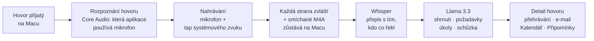

<div align="center">


# BrumlikAI

**AI poznámky k telefonátům, které vyřizuješ na Macu.**

BrumlikAI hovor nahraje, přepíše, sepíše všechno, co v něm skutečně zaznělo,<br>
a z domluvených schůzek udělá události v Kalendáři a z úkolů připomínky — sama.

[](#požadavky)
[](Package.swift)
[](https://github.com/Thominho/BrumlikAI/releases/latest)
[](LICENSE)
[](https://github.com/Thominho/BrumlikAI/stargazers)

[English](README.md) · **Čeština**

[**Stáhnout**](https://github.com/Thominho/BrumlikAI/releases/latest) · [Instalace](#instalace) · [Průvodce nastavením](#průvodce-nastavením-oprávnění) · [Časté otázky](#řešení-problémů-a-časté-otázky)

</div>

> [!TIP]
> **Je pro tebe BrumlikAI užitečná?** Dej prosím repozitáři ⭐ — je to jedno kliknutí a pomůže to, aby aplikaci našli i další.

---

## Obsah

- [Proč BrumlikAI](#proč-brumlikai)
- [Funkce](#funkce)
- [Jak to funguje](#jak-to-funguje)
- [Požadavky](#požadavky)
- [Instalace](#instalace)
- [Průvodce nastavením (oprávnění)](#průvodce-nastavením-oprávnění)
- [Používání](#používání)
- [Nastavení](#nastavení)
- [Automatické aktualizace](#automatické-aktualizace)
- [Soukromí a data](#soukromí-a-data)
- [Řešení problémů a časté otázky](#řešení-problémů-a-časté-otázky)
- [Diagnostika](#diagnostika)
- [Sestavení ze zdrojového kódu](#sestavení-ze-zdrojového-kódu)
- [Vydání nové verze](#vydání-nové-verze)
- [Struktura projektu](#struktura-projektu)
- [Nápady do budoucna](#nápady-do-budoucna)
- [Zapojení](#zapojení)
- [Licence](#licence)

## Proč BrumlikAI

Klienti volají s požadavky — *„udělejte ta tlačítka černá“*, *„přidejte nové fotky“*, *„můžeme se sejít v úterý?“* — a detaily se někde mezi hovorem a seznamem úkolů ztratí.

BrumlikAI bydlí v menu baru. Když přijmeš hovor na Macu, nahraje obě strany a minutu po zavěšení máš:

- **shrnutí všeho, co v hovoru skutečně zaznělo** — nikdy si nic nevymýšlí,
- **požadavky** klienta jako seznam,
- **úkoly** s termíny, jedním klikem v Připomínkách,
- domluvenou **schůzku**, jedním klikem v Kalendáři,
- celý **přepis s tím, kdo co řekl** — klikneš na větu a uslyšíš to místo hovoru,
- krátký **e‑mail pro klienta** s tím, na čem jste se domluvili, připravený k otevření v Mailu nebo rovnou k odeslání,
- volitelně připravený **pokyn pro tvůj AI nástroj** (Claude, Cursor, …), ve kterém už jsou weby, servery a stack klienta.

A když stejný klient zavolá znovu, panel hovoru ti připomene, o čem byl minulý hovor a co jsi měl udělat.

Celá aplikace je **česky i anglicky**.

## Funkce

| | |
|---|---|
| **Automatické nahrávání hovorů** | Pozná hovory, které přijmeš na Macu — hovory z iPhonu přes Continuity i FaceTime — a sama začne nahrávat. Ruční nahrávání je na jedno kliknutí. |
| **Soukromé hovory zůstanou soukromé** | Během každého nahrávaného hovoru se ukáže malý panel. Klikneš na **Soukromý – nenahrávat** a nahrávání se zastaví a na místě smaže — nic se neuloží ani neodešle. Rodinu a přátele přidáš do seznamu, který BrumlikAI nenahraje vůbec. |
| **Obě strany hovoru** | Tvůj hlas z mikrofonu, druhou stranu ze zvuku Macu přes Core Audio process tap. Aplikace, které na začátku hovoru jen přehrávaly hudbu nebo video, se nenahrávají. |
| **Kdo co řekl** | Obě strany se přepisují zvlášť, takže přepis ví, kdo co řekl — a v úkolech je to, co jsi slíbil *ty*, ne klient. Hlas druhé strany, který se z reproduktorů vrací do mikrofonu, se odfiltruje. |
| **Připomenutí minulého hovoru** | Když znovu volá někdo, s kým už jsi mluvil, panel hovoru ukáže, o čem byl minulý hovor, tvoje úkoly z něj a nadcházející schůzku. |
| **Přehrávání** | Nahrávku pustíš přímo v detailu hovoru, s posunem o ±15 s a rychlostí až 2×. Klikneš na větu v přepisu a hovor se přehraje od ní. |
| **E‑mail klientovi** | Jedním klikem vznikne krátký e‑mail s tím, na čem jste se domluvili, a dalšími kroky. Upravíš ho a otevřeš v Mailu — nebo ho rovnou odešleš přes vlastní SMTP server. |
| **Přepis a shrnutí** | Whisper large‑v3 a Llama 3.3 70B na DeepInfra. Ve shrnutí je jen to, co v hovoru zaznělo. |
| **Shrnutí pro tvůj obor** | Řekni BrumlikAI, co děláš — vývojář webů, grafik, účetní — a shrnutí se zaměří na detaily, které jsou pro tebe důležité. |
| **Úkoly → Připomínky** | Úkoly s termíny jedním klikem do Připomínek (se jménem klienta na začátku). |
| **Schůzky → Kalendář** | Domluvená schůzka se stane událostí v Kalendáři. Čas, délku i místo před uložením zkontroluješ a upravíš. |
| **Klienti a spravované systémy** | Profil každého klienta: weby, aplikace, CRM, servery, stack, poznámky. Firmu doplníš podle IČO z veřejného registru **ARES**. |
| **Vlastní telefonní seznam** | Jména volajících z Kontaktů; číslo jednou přejmenuješ a každý další hovor z něj se rovnou podepíše a přiřadí ke správné firmě. |
| **Pokyny pro AI (volitelné)** | Připravený pokyn pro jiný AI nástroj doplněný o weby, servery a stack klienta. Ve výchozím stavu vypnuté. |
| **Hledání** | Fulltext přes volající, firmy, přepisy, shrnutí i úkoly. |
| **Průvodce nastavením** | Živý stav všech oprávnění, návod krok za krokem a tlačítko rovnou na správné místo v Nastavení systému. |
| **Spolehlivé zpracování** | Srozumitelné chyby, tlačítko *Zkusit znovu*, které pokračuje tam, kde se zpracování zastavilo, obnova po pádu a upozornění, když byla některá strana hovoru potichu. |
| **Automatické aktualizace** | Podepsané aktualizace z GitHub Releases — zkontroluješ a nainstaluješ je v aplikaci, nebo se BrumlikAI aktualizuje sama, když zrovna netelefonuješ. |
| **Soukromí především** | Nahrávky zůstávají na tvém Macu. Na DeepInfra jde ke zpracování jen zvuk a přepis. Žádná analytika. |

## Jak to funguje



1. **Rozpoznání.** Každé dvě sekundy se BrumlikAI zeptá Core Audio, které procesy používají mikrofon. Když ho FaceTime nebo systémové služby pro hovory (`avconferenced`, `callservicesd`) drží pár sekund, probíhá hovor. Když ho asi šest sekund nepoužívají, hovor skončil — krátké ztlumení nahrávku nerozdělí.
2. **Nahrávání.** Nahrávají se dvě stopy zároveň: mikrofon (ty) a Core Audio process tap zvukového výstupu Macu (druhá strana). Samotná BrumlikAI a aplikace, které na začátku hovoru jen přehrávaly zvuk, jsou z tapu vyřazené.
3. **Volající.** Číslo nebo jméno se přečte z okna hovoru a dohledá nejdřív v telefonním seznamu BrumlikAI, potom v Kontaktech.
4. **Zpracování.** Stopy se smíchají do jednoho souboru M4A pro přehrávání a každá strana se navíc uloží zvlášť jako malý soubor s řečí. Whisper přepíše obě strany odděleně (dlouhé hovory po částech). BrumlikAI si nechá jen to, co na dané straně opravdu zaznělo — do ticha si Whisper rád něco vymyslí —, vyřadí hlas druhé strany, který mikrofon zachytil z reproduktorů, a obě strany spojí podle času do přepisu, který ví, kdo co řekl. Llama 3.3 70B pak vrátí strukturované shrnutí: jednovětý titulek, shrnutí, požadavky, tvoje úkoly, domluvenou schůzku a — pokud je zapneš — pokyn pro AI. Samostatné soubory stran se po dokončení přepisu smažou.
5. **Výsledek.** Přijde oznámení a hovor se objeví v historii v menu baru.
6. **Další hovor.** Když volá stejné číslo, klient nebo kontakt znovu, panel hovoru připomene titulek, úkoly a nadcházející schůzku z vašeho minulého hovoru.

## Požadavky

- **macOS 14.2 (Sonoma) nebo novější** — Apple Silicon i Intel.
- **Hovory na Macu:** iPhone se zapnutým *Voláním na jiných zařízeních* (stejný Apple účet, zapnutá Wi‑Fi a Bluetooth), nebo zvukové hovory FaceTime.
- **Mikrofon.** Mac mini, Mac Studio a Mac Pro vestavěný mikrofon nemají — použij sluchátka s mikrofonem.
- **Účet na DeepInfra** a API token. DeepInfra se platí podle využití; ceny najdeš na [deepinfra.com/pricing](https://deepinfra.com/pricing).

## Instalace

### 1. Stažení

1. Stáhni **BrumlikAI.zip** z [poslední verze](https://github.com/Thominho/BrumlikAI/releases/latest).
2. Rozbal ho a **BrumlikAI.app** přesuň do složky **Aplikace**. Jen odtud se dají instalovat aktualizace.

### 2. První spuštění

BrumlikAI je zdarma a není podepsaná vývojářským účtem Apple (Developer ID), proto ji macOS napoprvé zablokuje:

1. Otevři BrumlikAI. macOS napíše, že ji nemůže zkontrolovat kvůli škodlivému softwaru — klikni na **Hotovo**.
2. Otevři **Nastavení systému → Soukromí a zabezpečení**, sjeď dolů a u BrumlikAI klikni na **Přesto otevřít**. Potvrď heslem nebo Touch ID.
3. BrumlikAI se spustí a otevře úvodního průvodce.

<details>
<summary>Raději přes Terminál?</summary>

```bash
xattr -dr com.apple.quarantine /Applications/BrumlikAI.app
open /Applications/BrumlikAI.app
```

</details>

U aktualizací, které BrumlikAI nainstaluje sama, už tohle dělat nemusíš.

### 3. Úvodní průvodce

Zabere asi dvě minuty:

1. **Jazyk** — čeština nebo angličtina (kdykoli přepneš).
2. **Právní souhlas** — potvrdíš, že volající o nahrávání informuješ.
3. **DeepInfra API token** — uloží se do Klíčenky macOS.
4. **Co děláš** — jedna dvě věty o tom, co pro klienty děláš.
5. **Průvodce nastavením** — povolíš oprávnění (viz níže).
6. **Jak to používat** — krátký návod.

## Průvodce nastavením (oprávnění)

Průvodce nastavením (v úvodním průvodci, v *Nastavení → Průvodce oprávněními a nastavením* nebo přes banner v menu) ukazuje živý stav všeho, co BrumlikAI potřebuje, vysvětluje proč a má tlačítko, které o oprávnění požádá nebo otevře přesné místo v Nastavení systému.

| | Potřeba | K čemu | Kde povolit |
|---|---|---|---|
| **Mikrofon** | Povinné | Tvůj hlas | Nastavení systému → Soukromí a zabezpečení → Mikrofon |
| **Systémový zvuk** | Povinné | Hlas druhé strany | Nastavení systému → Soukromí a zabezpečení → nahrávání obrazovky a systémového zvuku → část jen pro systémový zvuk |
| **DeepInfra token** | Povinné | Přepis a shrnutí | BrumlikAI → Nastavení |
| **Hovory z iPhonu** | Povinné | Aby hovory zvonily na Macu | iPhone: Nastavení → Telefon → Volání na jiných zařízeních · Mac: FaceTime → Nastavení → hovory z iPhonu |
| **Kalendáře** | Doporučené | Ukládání schůzek | Nastavení systému → Soukromí a zabezpečení → Kalendáře |
| **Připomínky** | Doporučené | Ukládání úkolů | Nastavení systému → Soukromí a zabezpečení → Připomínky |
| **Oznámení** | Doporučené | „Nahrávání spuštěno“, „Hovor je shrnutý“ | Nastavení systému → Oznámení |
| **Kontakty** | Nepovinné | Jména volajících; poznání soukromých hovorů | Nastavení systému → Soukromí a zabezpečení → Kontakty |
| **Nahrávání obrazovky** | Nepovinné | Jméno volajícího z okna hovoru — díky němu BrumlikAI pozná soukromý hovor ještě před nahráváním | Nastavení systému → Soukromí a zabezpečení → nahrávání obrazovky a systémového zvuku |

> [!NOTE]
> macOS aplikacím neprozradí, jestli smějí nahrávat systémový zvuk. Tlačítko **Otestovat** v průvodci proto přehraje krátký zvuk a ověří, že ho BrumlikAI slyší.

## Používání

### Nahrávání hovorů

- **Automaticky:** přijmi hovor na Macu (oznámení v rohu obrazovky). Ikona v menu baru se změní na červené tlačítko nahrávání; po zavěšení BrumlikAI nahrávání ukončí a začne hovor zpracovávat. Automatické nahrávání funguje až po dokončení úvodního průvodce a potvrzení, že volající o nahrávání informuješ.
- **Ručně:** klikni na ikonu v menu baru → **Spustit nahrávání**. Ruční nahrávka zachytí všechno, co Mac přehrává (kromě BrumlikAI), a tvůj mikrofon — hodí se pro hovory přes WhatsApp, Teams nebo Zoom, nebo pro telefon na hlasitý odposlech.

> [!IMPORTANT]
> Nahrávání hovorů podléhá ochraně osobních údajů (GDPR) a často vyžaduje souhlas druhé strany. Na začátku každého hovoru jí řekni, že ho nahráváš, a ověř si pravidla, která se na tebe vztahují.

### Soukromé hovory

Jakmile se hovor začne nahrávat, objeví se nahoře na obrazovce malý panel a řekne ti, co se bude dít:

- **Nic neuděláš** — hovor se nahraje a po zavěšení shrne jako obvykle.
- **Soukromý – nenahrávat** — nahrávání se hned zastaví a smaže. Nic se neuloží, nic se neodešle ke zpracování a hovor se neobjeví ani v historii.

Po pár vteřinách se panel zmenší na malou pilulku, aby nepřekážel; **Soukromý…** ho znovu otevře i s vysvětlením. Stejné tlačítko najdeš během nahrávání i v okně v menu baru.

**Číslo, které se nikdy nenahraje.** Hned po označení hovoru jako soukromého se panel zeptá **Nenahrávat toto číslo už nikdy?** — klikneš na **Nikdy nenahrávat** a hovory s tímto číslem se už nenahrají (nebo **Jen tentokrát**). Seznam můžeš spravovat i:

- v **Nastavení → Soukromé hovory** — přidat číslo, případně i se jménem, nebo ho odebrat,
- v *Upravit kontakt* zapnutím **Hovory s tímto číslem nikdy nenahrávat**.

Když volá někdo ze seznamu, BrumlikAI vůbec nenahrává. Jen na chvíli ukáže **Soukromý hovor – nenahrává se** s tlačítkem **Přesto nahrávat** pro případ, že tenhle hovor přece jen potřebuješ.

> [!NOTE]
> Aby BrumlikAI poznal soukromého volajícího ještě před nahráváním, přečte číslo nebo jméno z okna hovoru (oprávnění *Nahrávání obrazovky*) a podívá se do tvých Kontaktů. macOS často ukazuje jen jméno kontaktu, proto přidej i jméno — tak, jak ho máš uložené v kontaktech. I bez těchto oprávnění můžeš kterýkoli hovor jedním kliknutím označit jako soukromý.

### Připomenutí minulého hovoru

Když volá někdo, s kým už jsi mluvil — stejné číslo, kontakt se stejným jménem nebo někdo ze stejné klientské firmy —, panel hovoru ukáže **Minulý hovor**:

- o čem hovor byl, jednou větou,
- **Tvoje úkoly** z něj (nejvýš tři),
- domluvenou **schůzku**, pokud je ještě před vámi.

**Otevřít** ukáže celý detail toho hovoru. S připomenutím zůstane panel otevřený o něco déle; když se zmenší na pilulku, **Minule** ho otevře znovu. Vypneš to v **Nastavení → Při hovoru připomenout minulý hovor**.

### Historie hovorů

Okno v menu baru ukazuje hovory s volajícím, firmou, časem a délkou. Červená ikona znamená nahrávání, kolečko zpracování a oranžový trojúhelník chybu. Klikem otevřeš detail.

### Detail hovoru

| Část | Co tam uděláš |
|---|---|
| **Kontakt** | Jméno, číslo a firma. *Upravit kontakt* volajícího přejmenuje a přiřadí firmu; změna platí i pro všechny další hovory z toho čísla. |
| **Shrnutí pro mě** | Vše, co v hovoru skutečně zaznělo, a požadavky klienta. Kopírování jedním klikem. |
| **Pokyn pro moji AI** | Jen když ho zapneš v Nastavení. Zkopíruj ho do Claude, Cursoru nebo jiného AI nástroje. |
| **Úkoly z hovoru** | U každého *Přidat do Připomínek*; na začátek se přidá jméno klienta. |
| **Navržená schůzka** | Zkontroluj ji, *Upravit* čas, délku, místo nebo poznámky, a pak *Přidat do Kalendáře*. |
| **E‑mail klientovi** | *Napsat e‑mail* připraví krátký e‑mail — na čem jste se domluvili a další kroky — v jazyce hovoru a s adresou z karty klienta. Upravíš ho a pak *Otevřít v Mailu*, nebo *Odeslat* přes vlastní SMTP server (nejdřív to potvrdíš). *Napsat znovu* vytvoří novou verzi. |
| **Nahrávka a přepis** | Přehraješ hovor s posunem o ±15 s a rychlostí 1×–2×. Přepis ukazuje, kdo co řekl — *Vy* a jméno volajícího — i s časy; klikneš na větu a hovor se přehraje od ní. *Kopírovat* vezme i jména a časy. |
| **Kontrola zvuku** | Upozorní, když byla tvoje strana nebo druhá strana úplně potichu. |
| **Zpracování selhalo** | Ukáže důvod; *Zkusit znovu* pokračuje tam, kde se zastavilo (třeba po opravě tokenu). |
| **Smazat hovor** | Ikona koše nahoře nevratně smaže nahrávku, přepis i shrnutí. Hovor, který se ještě zpracovává, přestane odesílat. |

### Klienti

*Klienti* v menu otevřou seznam klientů:

- **Přidat klienta → Ručně**, nebo **→ Podle IČ (ARES)**: zadáš IČO a BrumlikAI doplní název, adresu a DIČ z veřejného registru (jen v české verzi).
- U každého klienta: kontaktní osoba, e‑mail, telefon, adresa, poznámky.
- **Spravované systémy:** typ (web, aplikace, CRM, server, jiné), název, URL, server / host, stack (WordPress, Laravel, …), poznámky — a *nápověda* k přihlášení (kde přihlašovací údaje najdeš, nikdy skutečné heslo). Nápověda k přihlášení se AI nikdy neposílá.

### Telefonní seznam a jména volajících

Volající se hledá v tomto pořadí: **telefonní seznam BrumlikAI** (jména nastavená přes *Upravit kontakt*) → **Kontakty macOS** → číslo nebo jméno z okna hovoru. Přiřazení firmy v *Upravit kontakt* platí i pro všechny dřívější a budoucí hovory z toho čísla.

### Pokyny pro AI

Zapni **Nastavení → Zobrazovat pokyny pro AI pod shrnutím** a u každého hovoru dostaneš připravený pokyn pro jiný AI nástroj — například *„Změň barvu tlačítek na černou na pekarna.cz (WordPress, server 22.34.23.32) …“*. Pokyn vychází ze spravovaných systémů klienta a je formulovaný pro tvůj obor. Po přiřazení nebo změně klienta se přegeneruje.

### Hledání

Pole nad historií hledá ve volajících, číslech, firmách, přepisech, shrnutích, požadavcích i úkolech.

### E‑maily klientům

V detailu hovoru **Napsat e‑mail** udělá z hovoru krátký e‑mail pro klienta: poděkování za hovor, na čem jste se domluvili, kdo co udělá a do kdy, a schůzku, pokud jste ji domluvili. Použije jen to, co zaznělo, vynechá interní detaily a končí pozdravem, aby po něm následoval tvůj podpis. Jak e‑mail odejde, nastavíš v **Nastavení → E‑maily klientům**:

- **Aplikaci Mail** (výchozí) — e‑mail se otevře v Mailu s vyplněnou adresou, předmětem i textem; zkontroluješ ho a odešleš tam.
- **Vlastní SMTP server** — BrumlikAI ho odešle sám, když klikneš na **Odeslat** a potvrdíš to. Vyplň server, zabezpečení, port, uživatele, heslo, jméno a adresu odesílatele a klikni na **Vyzkoušet připojení** (přihlásí se a odhlásí, nic se neodešle).

> [!NOTE]
> Spojení s tvým SMTP serverem je vždy šifrované — **SSL/TLS** (obvykle port 465) nebo **STARTTLS** (obvykle 587). Když server STARTTLS nenabízí, BrumlikAI raději skončí, než aby poslal heslo nešifrovaně. Heslo je uložené v Klíčence macOS. E‑maily odeslané přes SMTP se neukážou ve složce *Odeslané*, proto je ve výchozím stavu zapnuté **Posílat skrytou kopii i mně**.

## Nastavení

| Nastavení | Co dělá |
|---|---|
| **Průvodce oprávněními a nastavením** | Otevře průvodce nastavením; odznak ukazuje, kolik povinných kroků chybí. |
| **Jazyk** | Čeština nebo angličtina pro celou aplikaci i pro shrnutí. |
| **DeepInfra API token** | Uložený v Klíčence. *Ověřit token* ho vyzkouší u DeepInfra. |
| **Jazyk hovorů** | *Rozpoznat automaticky*, čeština, slovenština, angličtina nebo němčina — pro přepis. |
| **Zobrazovat pokyny pro AI pod shrnutím** | Ve výchozím stavu vypnuté. |
| **Co pro klienty děláš** | Zaměří shrnutí (a pokyny pro AI) na tvůj obor. |
| **Výchozí kalendář / seznam Připomínek** | Kam se ukládají schůzky a úkoly. |
| **Rozpoznávat hovory automaticky** | Ve výchozím stavu zapnuté. |
| **Při hovoru připomenout minulý hovor** | Ve výchozím stavu zapnuté. Panel hovoru ukáže, o čem byl tvůj minulý hovor s tímto člověkem. |
| **Druhou stranu informuji o nahrávání** | Nutné pro automatické nahrávání. |
| **Spouštět BrumlikAI po přihlášení** | Přidá BrumlikAI mezi položky po přihlášení. |
| **Soukromé hovory** | Čísla (nebo jména kontaktů), jejichž hovory se nikdy nenahrají. |
| **E‑maily klientům** | Odesílání přes aplikaci Mail (výchozí) nebo vlastní SMTP server: server, SSL/TLS nebo STARTTLS, port, uživatel, heslo (v Klíčence), jméno a adresa odesílatele, skrytá kopie tobě, *Vyzkoušet připojení*. |
| **Aktualizace** | Tvoje verze, *Zkontrolovat*, automatická kontrola (zapnutá) a automatická instalace (vypnutá). |
| **Diagnostika** | Pětisekundová zkušební nahrávka, vstup mikrofonu a aplikace, které právě používají zvuk. |
| **Spustit průvodce znovu** | Spustí znovu úvodního průvodce. |

## Automatické aktualizace

- BrumlikAI kontroluje [GitHub Releases](https://github.com/Thominho/BrumlikAI/releases) 30 sekund po spuštění a pak každých 6 hodin (*Nastavení → Aktualizace*).
- Když vyjde nová verze, v menu a v Nastavení se objeví banner **Nainstalovat a restartovat**. Se zapnutou volbou *Aktualizace instalovat automaticky* ji BrumlikAI nainstaluje sama — ale jen když se zrovna nenahrává ani nezpracovává hovor.
- **Každá aktualizace je podepsaná.** Každé vydání obsahuje `BrumlikAI.zip` a `BrumlikAI.zip.sig`, podpis Ed25519 vytvořený soukromým klíčem, který má jen správce projektu. Aplikace obsahuje odpovídající veřejný klíč a nic s nesedícím podpisem nenainstaluje — takže ani podvržené stažení, ani ukradený účet na GitHubu nemůže do tvého Macu dostat cizí kód.
- Aktualizace stahuje aplikace sama, takže je macOS neblokuje jako první stažení.
- Aby se mohla sama nahradit, musí BrumlikAI běžet ze složky **Aplikace** (nebo jiné, do které můžeš zapisovat).
- Po aktualizaci BrumlikAI otevře průvodce nastavením. Bez vývojářského účtu Apple může nová verze přijít o některá oprávnění — viz [časté otázky](#řešení-problémů-a-časté-otázky).

## Soukromí a data

**Na tvém Macu**

| Co | Kde |
|---|---|
| Nahrávky (M4A) | `~/Library/Application Support/BrumlikAI/recordings/` |
| Přepisy, shrnutí, koncepty e‑mailů, historie hovorů | `~/Library/Application Support/BrumlikAI/recordings.json` |
| Klienti | `~/Library/Application Support/BrumlikAI/clients.json` |
| Telefonní seznam a soukromé hovory | `~/Library/Application Support/BrumlikAI/phonebook.json` |
| DeepInfra token, heslo k SMTP | Klíčenka macOS |
| Nastavení | uživatelské předvolby macOS (`cz.brumlik.BrumlikAI`) |

Během přepisu je vedle nahrávky ještě každá strana uložená zvlášť jako malý soubor; jakmile je přepis hotový, smaže se. Smazáním hovoru v aplikaci se smaže i jeho zvuk. Hovor označený jako **Soukromý – nenahrávat** se smaže už během nahrávání a nikdy neopustí tvůj Mac; hovory s čísly ze soukromého seznamu se nenahrávají vůbec.

**Co se posílá přes internet**

| Komu | Co | Kdy |
|---|---|---|
| DeepInfra | Zvuk hovoru — každá strana zvlášť | Přepis |
| DeepInfra | Přepis; popis tvé práce; u přiřazeného klienta jméno, IČO, kontakty a spravované systémy (nikdy nápověda k přihlášení) | Shrnutí a pokyn pro AI |
| DeepInfra | Přepis a shrnutí hovoru, jméno klienta a kontaktní osoby | Když klikneš na *Napsat e‑mail* |
| Tvůj SMTP server | E‑mail klientovi (a skrytá kopie tobě, pokud je zapnutá) | Když klikneš na *Odeslat* |
| GitHub | Dotaz na poslední verzi | Kontrola aktualizací |
| ARES (ares.gov.cz) | IČO, které zadáš | Vyhledání v ARES |

Žádná analytika ani jiné servery. Jak s daty zachází DeepInfra, najdeš v jejich [zásadách ochrany soukromí](https://deepinfra.com/privacy).

## Řešení problémů a časté otázky

<details>
<summary><b>Druhá strana je na nahrávce potichu</b></summary>

Otevři průvodce nastavením → **Systémový zvuk** → **Otestovat**. Když test selže, otevři Nastavení systému → Soukromí a zabezpečení → nahrávání obrazovky a systémového zvuku a zapni BrumlikAI v části jen pro systémový zvuk (pokud tam chybí, přidej ji tlačítkem **+**). Pak test zopakuj.
</details>

<details>
<summary><b>„Mikrofon nahrál jen ticho“</b></summary>

Upozornění uvádí, jaké vstupní zařízení se použilo. Nejčastější příčiny:

- Mac nemá mikrofon (Mac mini, Mac Studio, Mac Pro) — připoj sluchátka s mikrofonem.
- Jako vstup je vybrané virtuální zařízení (třeba od aplikace pro vzdálenou plochu nebo sdílení obrazovky). V Nastavení systému → Zvuk → Vstup vyber skutečný mikrofon.
- Přístup k mikrofonu není povolený — zkontroluj průvodce nastavením.
</details>

<details>
<summary><b>Hovor se nenahrál automaticky</b></summary>

- Hovor přijmi **na Macu**; hovor přijatý jen na iPhonu přes Mac nejde.
- Zkontroluj *Nastavení → Rozpoznávat hovory automaticky* a že máš dokončeného úvodního průvodce a potvrzené informování volajících.
- Během hovoru otevři *Nastavení → Diagnostika → Aplikace, které právě používají zvuk*: aplikace, která hovor obsluhuje, by měla mít štítek **hovor** a používat mikrofon. Pokud žádná nemá, spusť nahrávání ručně.
</details>

<details>
<summary><b>„DeepInfra vrátila chybu 401“</b></summary>

Token je špatně, vypršel nebo byl smazán. V dashboardu DeepInfra (API Keys) vytvoř nový, vlož ho v Nastavení a klikni na **Ověřit token**. Pak otevři hovor a klikni na **Zkusit znovu**.
</details>

<details>
<summary><b>„Zpracování selhalo“</b></summary>

V detailu je důvod (chybí internet, token, prázdná nahrávka, …). Oprav ho a klikni na **Zkusit znovu** — hotové kroky se neopakují.
</details>

<details>
<summary><b>V přepisu nejsou jména, nebo jsou klientova slova připsaná mně</b></summary>

Kdo co řekl, pozná BrumlikAI jen z obou stran hovoru: když byla jedna z nich potichu (viz upozornění na zvuk v detailu hovoru), přepis se ukáže bez jmen. Přes reproduktory Macu slyší mikrofon i druhou stranu; BrumlikAI vyřadí to, co zaznělo ve stejnou chvíli na obou stranách, ale nejčistší výsledek dají sluchátka. Hovory nahrané staršími verzemi jména nemají.
</details>

<details>
<summary><b>Jaké nastavení SMTP použít?</b></summary>

To, které tvůj poskytovatel e‑mailu uvádí pro odesílání pošty: název serveru, port a *SSL/TLS* (obvykle 465) nebo *STARTTLS* (obvykle 587). Uživatel bývá celá e‑mailová adresa. Někteří poskytovatelé, třeba Gmail, chtějí místo běžného hesla heslo pro aplikace. Před prvním e‑mailem vše ověříš tlačítkem **Vyzkoušet připojení**.
</details>

<details>
<summary><b>E‑maily odeslané z BrumlikAI nejsou ve složce Odeslané</b></summary>

Poštu odeslanou přes SMTP server do *Odeslaných* neukládá. Nech zapnuté **Posílat skrytou kopii i mně** (ve výchozím stavu je) a každý e‑mail ti přijde i do schránky. Jestli ho chceš mít v *Odeslaných*, vyber v *Nastavení → E‑maily klientům* **Aplikaci Mail**.
</details>

<details>
<summary><b>Čas schůzky nesedí</b></summary>

U navržené schůzky klikni na **Upravit** a před přidáním do kalendáře nastav čas, délku a místo. AI schůzku vyplní jen tehdy, když se domluvilo konkrétní datum a čas.
</details>

<details>
<summary><b>Po aktualizaci se macOS znovu ptá na oprávnění nebo něco přestalo fungovat</b></summary>

Bez vývojářského účtu Apple může macOS novou verzi považovat za jinou aplikaci. BrumlikAI po každé aktualizaci otevře průvodce nastavením — povol, co chybí. Když se oprávnění ukazuje jako povolené, ale nefunguje, vypni a znovu zapni BrumlikAI v daném seznamu v Nastavení systému (nebo ji odeber tlačítkem **−** a přidej znovu) a v průvodci spusť **Otestovat**.
</details>

<details>
<summary><b>macOS chce heslo, aby BrumlikAI mohla použít Klíčenku</b></summary>

Jde o DeepInfra token. Po aktualizaci se macOS může jednou zeptat; zvol **Vždy povolit**.
</details>

<details>
<summary><b>„Pro instalaci aktualizací přesuň BrumlikAI do složky Aplikace“</b></summary>

BrumlikAI běží přímo ze stažených souborů (macOS ji pak spouští z dočasného místa jen pro čtení). Přesuň ji do Aplikací a otevři odtud.
</details>

<details>
<summary><b>Funguje to s WhatsAppem, Teams nebo Zoomem?</b></summary>

Ano, přes ruční nahrávání. Automatické rozpoznání je pro telefonní hovory a FaceTime.
</details>

<details>
<summary><b>Kolik to stojí?</b></summary>

BrumlikAI je zdarma. Za přepis a shrnutí hovorů platíš DeepInfra podle využití — viz [deepinfra.com/pricing](https://deepinfra.com/pricing).
</details>

<details>
<summary><b>Kde najdu svoje nahrávky?</b></summary>

V `~/Library/Application Support/BrumlikAI/` — viz [Soukromí a data](#soukromí-a-data).
</details>

## Diagnostika

**V aplikaci:** *Nastavení → Diagnostika*

- **Otestovat nahrávání (5 s)** — pusť video a řekni pár slov; uvidíš, jestli se nahrává zvuk druhé strany i tvůj mikrofon, včetně hlasitosti.
- **Vstup mikrofonu** — zařízení, ze kterého BrumlikAI nahrává tvůj hlas.
- **Aplikace, které právě používají zvuk** — které aplikace používají mikrofon nebo přehrávají zvuk a které BrumlikAI považuje za hovor.

**Z Terminálu:** samotest, který nahrává, volitelně nahrávku zpracuje a zapíše výsledek do JSONu:

```bash
open -W -n /Applications/BrumlikAI.app --args --self-test 20 --report ~/Desktop/brumlik-selftest.json
```

S `--process` nahrávku i přepíše a shrne (použije tvůj DeepInfra token). Ve výsledku je hlasitost obou stran, vstup mikrofonu a přístup k němu, aplikace používající zvuk, jestli byl rozpoznán hovor, stav nebo chyba zpracování, přepis a shrnutí. Zkušební nahrávka se potom smaže.

Panel hovoru zkontroluješ i bez hovoru: `--preview-call-panel <složka>` na chvíli ukáže každý jeho stav (nic se nenahrává), uloží PNG každého z nich a `frames.json` s polohou panelu a aplikaci ukončí:

```bash
open -W -n /Applications/BrumlikAI.app --args --preview-call-panel ~/Desktop/brumlik-panel
```

`--preview-call-detail <složka>` otevře smyšlený hovor v okně detailu — s přehrávačem, přepisem s tím, kdo co řekl, a e‑mailem —, uloží snímky jeho horní a spodní části a skončí. Pracuje v dočasné složce, takže na tvoje hovory nesáhne:

```bash
open -W -n /Applications/BrumlikAI.app --args --preview-call-detail ~/Desktop/brumlik-detail
```

## Sestavení ze zdrojového kódu

Potřebuješ macOS 14.2+ a Xcode 15.1 nebo novější (případně jeho nástroje příkazové řádky).

```bash
git clone https://github.com/Thominho/BrumlikAI.git
cd BrumlikAI
./build-app.sh --run      # sestaví build/BrumlikAI.app a spustí ji
swift test                # unit testy
```

`./build-app.sh --universal` sestaví aplikaci pro Apple Silicon i Intel.

> [!TIP]
> **Oprávnění, která přežijí nové sestavení.** Ve výchozím stavu je aplikace podepsaná ad hoc, takže ji macOS po každém sestavení bere jako novou a ptá se na oprávnění znovu. Jednou si vytvoř vlastní podepsaný certifikát — *Klíčenka → Asistent certifikátů → Vytvořit certifikát…*, název **BrumlikAI Signing**, typ identity *Vlastní podepsaný kořenový*, typ certifikátu *Podepisování kódu* — a sestavuj takhle:
>
> ```bash
> SIGN_IDENTITY="BrumlikAI Signing" ./build-app.sh
> ```

## Vydání nové verze

Vydání se zveřejňují na GitHub Releases, kde je nainstalované aplikace najdou.

**Jednorázová příprava**

1. Nainstaluj [GitHub CLI](https://cli.github.com) a přihlas se: `brew install gh && gh auth login`.
2. Vytvoř podpisový klíč pro aktualizace:
   ```bash
   swift scripts/update-keys.swift generate
   ```
   Soukromý klíč se uloží do `~/.brumlikai/update-signing-key`; vypsaný veřejný klíč vlož do `Resources/Info.plist` → `BrumlikUpdatePublicKey`.
3. Vytvoř vlastní certifikát pro podepisování kódu (viz [výše](#sestavení-ze-zdrojového-kódu)), aby si uživatelé po aktualizaci zachovali oprávnění.

> [!WARNING]
> Soubor `~/.brumlikai/update-signing-key` si zálohuj (třeba ve správci hesel) a nikdy ho necommituj. Bez něj nevydáš aktualizaci, kterou by nainstalované aplikace přijaly; kdo ho má, ten ano.

**Každé vydání**

```bash
SIGN_IDENTITY="BrumlikAI Signing" scripts/release.sh 0.3.0 "Co je nového ve verzi 0.3.0"
```

Skript ověří, že klíč sedí k aplikaci, zvýší verzi, sestaví univerzální aplikaci, zabalí ji a podepíše, commitne, otaguje, pushne a vytvoří vydání na GitHubu s `BrumlikAI.zip` a `BrumlikAI.zip.sig`. Nainstalované aplikace ho najdou do šesti hodin, nebo hned přes *Zkontrolovat*.

## Struktura projektu

```
BrumlikAI/
├── Package.swift                   Swift balíček (macOS 14.2+)
├── build-app.sh                    Sestaví a podepíše build/BrumlikAI.app
├── scripts/
│   ├── release.sh                  Zveřejní podepsané vydání na GitHubu
│   └── update-keys.swift           Vytvoří klíč pro aktualizace, podepisuje archivy
├── Resources/
│   ├── Info.plist                  Údaje balíčku, texty oprávnění, repozitář a veřejný klíč aktualizací
│   └── BrumlikAI.entitlements
├── Sources/BrumlikAI/
│   ├── BrumlikAIApp.swift          Vstupní bod aplikace
│   ├── AppDelegate.swift           Menu bar, okna, spuštění
│   ├── Core/
│   │   ├── AppState.swift          Nahrávky, klienti, telefonní seznam, nastavení
│   │   ├── Models.swift            Recording, Client, CallSummary, MeetingProposal, TaskProposal…
│   │   ├── Transcript.swift        Kdo co řekl: hlasitost, ozvěna, spojení obou stran
│   │   ├── CallBriefing.swift      Připomenutí minulého hovoru se stejným volajícím
│   │   ├── Email.swift             Koncepty e-mailů, nastavení SMTP, adresy
│   │   ├── Localization.swift      Anglické a české texty
│   │   ├── SetupChecklist.swift    Živý stav oprávnění pro průvodce nastavením
│   │   ├── RecordingStore.swift    Soubory na disku
│   │   ├── ClientStore.swift, PhonebookStore.swift, Keychain.swift
│   ├── Services/
│   │   ├── CallDetector.swift      Spouští a zastavuje nahrávání podle hovoru
│   │   ├── CoreAudioProcesses.swift Které procesy používají mikrofon a reproduktory
│   │   ├── CallerDetector.swift    Jméno nebo číslo volajícího z okna hovoru
│   │   ├── AudioRecorder.swift     Nahrává obě strany hovoru
│   │   ├── SystemAudioTap.swift    Core Audio process tap (druhá strana)
│   │   ├── MicRecorder.swift       Mikrofon (ty)
│   │   ├── AudioMixer.swift, AudioChunker.swift
│   │   ├── AudioLevels.swift       Malá kopie řeči každé strany, hlasitost v čase
│   │   ├── CallTranscriber.swift   Přepíše obě strany zvlášť a spojí je
│   │   ├── DeepInfraClient.swift   Přepis přes Whisper, shrnutí a e-maily přes Llamu
│   │   ├── RecordingCoordinator.swift Celý proces: nahrát → smíchat → přepsat → shrnout
│   │   ├── SMTPClient.swift        Odesílání e-mailů přes SMTP (SSL/TLS nebo STARTTLS)
│   │   ├── MailComposer.swift      Otevření e-mailu v Mailu
│   │   ├── CalendarService.swift, RemindersService.swift, ContactsService.swift, AresClient.swift
│   │   ├── UpdateChecker.swift     Podepsané aktualizace z GitHub Releases
│   │   ├── LaunchAgent.swift       Spuštění po přihlášení
│   │   ├── SelfTest.swift          Diagnostika, --self-test a --preview-call-panel
│   │   └── CallDetailPreview.swift --preview-call-detail
│   └── UI/                         SwiftUI obrazovky: menu, panel hovoru (CallOverlay), detail hovoru s přehrávačem
│                                   (CallPlayback) a e-mailem (FollowUpEmailCard), klienti, nastavení, průvodci
└── Tests/BrumlikAITests/           Unit testy: soukromé hovory s falešným nahrávačem, kdo co řekl na generovaném
                                    zvuku, připomenutí minulého hovoru, SMTP proti naskriptovanému serveru
```

## Nápady do budoucna

- Výběr AI modelů v Nastavení.
- Šifrování nahrávek na disku.
- Podpis vývojářským účtem Apple a notarizace.

## Zapojení

Hlášení chyb, nápady i pull requesty jsou vítané — založ [issue](https://github.com/Thominho/BrumlikAI/issues). Před odesláním pull requestu prosím spusť `swift test`.

<div align="center">

**Pokud ti BrumlikAI šetří čas, ⭐ na GitHubu je nejlepší způsob, jak poděkovat.**

</div>

## Licence

[MIT](LICENSE) © 2026 Thominho
