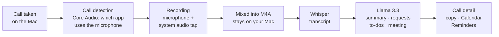

<div align="center">


# BrumlikAI

**AI notes for the phone calls you take on your Mac.**

BrumlikAI records the call, transcribes it, writes down everything that was actually said,<br>
and turns agreed meetings into calendar events and to‑dos into reminders — on its own.

[](#requirements)
[](Package.swift)
[](https://github.com/Thominho/BrumlikAI/releases/latest)
[](LICENSE)
[](https://github.com/Thominho/BrumlikAI/stargazers)

**English** · [Čeština](README.cs.md)

[**Download**](https://github.com/Thominho/BrumlikAI/releases/latest) · [Install](#installation) · [Setup guide](#setup-guide-permissions) · [FAQ](#troubleshooting--faq)

</div>

> [!TIP]
> **Is BrumlikAI useful to you?** Please give the repository a ⭐ — it takes one click and helps other people find it.

---

## Contents

- [Why BrumlikAI](#why-brumlikai)
- [Features](#features)
- [How it works](#how-it-works)
- [Requirements](#requirements)
- [Installation](#installation)
- [Setup guide (permissions)](#setup-guide-permissions)
- [Using BrumlikAI](#using-brumlikai)
- [Settings](#settings)
- [Automatic updates](#automatic-updates)
- [Privacy & data](#privacy--data)
- [Troubleshooting & FAQ](#troubleshooting--faq)
- [Diagnostics](#diagnostics)
- [Building from source](#building-from-source)
- [Releasing a new version](#releasing-a-new-version)
- [Project structure](#project-structure)
- [Ideas for the future](#ideas-for-the-future)
- [Contributing](#contributing)
- [License](#license)

## Why BrumlikAI

Clients call with requests — *"make the buttons black"*, *"add the new photos"*, *"can we meet on Tuesday?"* — and the details get lost somewhere between the call and your to‑do list.

BrumlikAI lives in your menu bar. When you take a call on your Mac, it records both sides, and a minute after you hang up you have:

- a **summary of everything that was actually said** — it never makes things up,
- the client's **requests** as a list,
- **to‑dos** with deadlines, one click away from Apple Reminders,
- the agreed **meeting**, one click away from Apple Calendar,
- the full **transcript**, searchable later,
- optionally a ready‑to‑paste **prompt for your AI tool** (Claude, Cursor, …) with the client's websites, servers and stack already in it.

The whole app is available in **English and Czech**.

## Features

| | |
|---|---|
| **Automatic call recording** | Detects calls you take on the Mac — iPhone calls over Continuity and FaceTime — and starts recording on its own. Manual recording is one click away. |
| **Both sides of the call** | Your voice from the microphone, the other party from the Mac's audio through a Core Audio process tap. Apps that were only playing music or video when the call started are left out. |
| **Transcript & summary** | Whisper large‑v3 and Llama 3.3 70B on DeepInfra. The summary contains only what was said in the call. |
| **Summaries for your field** | Tell BrumlikAI what you do — web developer, graphic designer, accountant — and the summaries focus on the details that matter to you. |
| **To‑dos → Reminders** | Action items with deadlines, added to Apple Reminders with one click (the client's name in front). |
| **Meetings → Calendar** | Agreed meetings become Calendar events. Check and edit the time, length and place before saving. |
| **Clients & managed systems** | A profile for every client: websites, apps, CRMs, servers, technology stack, notes. With the Czech interface, fill in companies from the public **ARES** registry by company ID (IČO). |
| **Your own phonebook** | Caller names from Contacts; rename a number once and every future call from it is labelled and assigned to the right company. |
| **AI prompts (optional)** | A ready‑to‑paste instruction for another AI tool, enriched with the client's sites, servers and stack. Off by default. |
| **Search** | Full‑text search across callers, companies, transcripts, summaries and to‑dos. |
| **Setup guide** | Live status of every permission, with step‑by‑step instructions and a button straight to the right place in System Settings. |
| **Reliable processing** | Clear error messages, a *Try again* button that continues where processing stopped, recovery after a crash, warnings when a side of the call was silent. |
| **Automatic updates** | Signed updates from GitHub Releases — check and install from the app, or let it update itself while you're not on a call. |
| **Private by design** | Recordings stay on your Mac. Only the audio and the transcript go to DeepInfra for processing. No analytics. |

## How it works



1. **Detection.** Every two seconds BrumlikAI asks Core Audio which processes are using the microphone. When FaceTime or the macOS call services (`avconferenced`, `callservicesd`) capture it for a few seconds, a call is on. When they stop for about six seconds, the call has ended — a short mute doesn't split the recording.
2. **Recording.** Two tracks are recorded at once: the microphone (you) and a Core Audio process tap of the Mac's audio output (the other party). BrumlikAI itself and apps that were only playing audio when the call started are excluded from the tap.
3. **Caller.** The number or name is read from the call window and looked up in BrumlikAI's phonebook first, then in Contacts.
4. **Processing.** The tracks are mixed into one M4A file. Whisper turns it into a transcript (long calls are split into parts), and Llama 3.3 70B returns a structured summary: the summary, the requests, to‑dos, an agreed meeting and — if you turned it on — an AI prompt.
5. **Result.** You get a notification and the call appears in the menu‑bar history.

## Requirements

- **macOS 14.2 (Sonoma) or newer** — Apple silicon or Intel.
- **Calls on the Mac:** an iPhone with *Calls on Other Devices* turned on (same Apple Account, Wi‑Fi and Bluetooth on), or FaceTime audio calls.
- **A microphone.** Mac mini, Mac Studio and Mac Pro have none built in — use a headset.
- **A DeepInfra account** and API token. DeepInfra is pay‑as‑you‑go; see [deepinfra.com/pricing](https://deepinfra.com/pricing).

## Installation

### 1. Download

1. Download **BrumlikAI.zip** from the [latest release](https://github.com/Thominho/BrumlikAI/releases/latest).
2. Unzip it and move **BrumlikAI.app** to your **Applications** folder. Updates can only be installed there.

### 2. First launch

BrumlikAI is free and isn't signed with an Apple Developer ID, so macOS blocks it the first time:

1. Open BrumlikAI. macOS says it can't check it for malicious software — click **Done**.
2. Open **System Settings → Privacy & Security**, scroll down and click **Open Anyway** next to BrumlikAI. Confirm with your password or Touch ID.
3. BrumlikAI starts and opens the onboarding.

<details>
<summary>Prefer Terminal?</summary>

```bash
xattr -dr com.apple.quarantine /Applications/BrumlikAI.app
open /Applications/BrumlikAI.app
```

</details>

Updates that BrumlikAI installs itself don't need this again.

### 3. Onboarding

The onboarding takes about two minutes:

1. **Language** — English or Czech (switch any time).
2. **Legal consent** — you confirm that you tell callers about the recording.
3. **DeepInfra API token** — stored in the macOS Keychain.
4. **Your work** — one or two sentences about what you do for clients.
5. **Setup guide** — allow the permissions (see below).
6. **How to use it** — a short walkthrough.

## Setup guide (permissions)

The setup guide (onboarding, *Settings → Permissions & setup guide*, or the banner in the menu) shows the live status of everything BrumlikAI needs, explains why, and has a button that asks for the permission or opens the exact place in System Settings.

| | Needed | What it's for | Where to allow it |
|---|---|---|---|
| **Microphone** | Required | Your voice | System Settings → Privacy & Security → Microphone |
| **System audio** | Required | The other party's voice | System Settings → Privacy & Security → Screen & System Audio Recording → *System Audio Recording Only* |
| **DeepInfra token** | Required | Transcript and summary | BrumlikAI → Settings |
| **Calls from iPhone** | Required | Calls ringing on the Mac | iPhone: Settings → Phone → Calls on Other Devices · Mac: FaceTime → Settings → *Calls from iPhone* |
| **Calendars** | Recommended | Saving meetings | System Settings → Privacy & Security → Calendars |
| **Reminders** | Recommended | Saving to‑dos | System Settings → Privacy & Security → Reminders |
| **Notifications** | Recommended | "Recording started", "Summary ready" | System Settings → Notifications |
| **Contacts** | Optional | Caller names | System Settings → Privacy & Security → Contacts |
| **Screen recording** | Optional | Reading the caller's name from the call window | System Settings → Privacy & Security → Screen & System Audio Recording |

> [!NOTE]
> macOS doesn't tell apps whether they may record system audio. The guide's **Test** button therefore plays a short sound and checks that BrumlikAI hears it.

## Using BrumlikAI

### Recording calls

- **Automatically:** answer the call on your Mac (the notification in the corner of the screen). The menu‑bar icon turns into a red record button; when you hang up, BrumlikAI stops and starts processing. Automatic recording only works after the onboarding is finished and you have confirmed that you tell callers about it.
- **Manually:** click the menu‑bar icon → **Start recording**. Manual recordings capture everything the Mac plays (except BrumlikAI) plus your microphone — handy for WhatsApp, Teams or Zoom calls, or a phone on speaker.

> [!IMPORTANT]
> Recording calls is subject to data protection law (GDPR in the EU) and often requires the other party's consent. Tell them at the start of every call that it's being recorded, and check the rules that apply to you.

### Call history

The menu‑bar window lists your calls with the caller, company, time and length. A red icon means recording, a spinner means processing, an orange triangle means something failed. Click a call to open its detail.

### Call detail

| Part | What you can do |
|---|---|
| **Contact** | Name, number and company. *Edit contact* lets you rename the caller and assign a company; the change is remembered for every future call from that number. |
| **Summary for you** | Everything the call actually contained, plus the client's requests. One‑click copy. |
| **Prompt for your AI** | Only when turned on in Settings. Copy it into Claude, Cursor or another AI tool. |
| **To‑dos from the call** | *Add to Reminders* for each one; the client's name is added in front. |
| **Proposed meeting** | Check it, *Edit* the time, length, place or notes, then *Add to Calendar*. |
| **Full transcript** | Expand and copy. |
| **Audio check** | Warns when your side or the other party's side was completely silent. |
| **Processing failed** | Shows the reason; *Try again* continues where it stopped (e.g. after you fix the token). |

### Clients

*Clients* in the menu opens the client list:

- **Add client → Manually**, or with the Czech interface **→ By company ID (ARES)**: enter the IČO and BrumlikAI fills in the name, address and VAT ID from the public registry.
- For each client: contact person, email, phone, address, notes.
- **Managed systems:** type (website, app, CRM, server, other), name, URL, server / host, stack (WordPress, Laravel, …), notes — and a credentials *hint* (where the login is kept; never a real password). Credential hints are never sent to the AI.

### Phonebook & caller names

The caller is identified in this order: **your BrumlikAI phonebook** (names you set with *Edit contact*) → **macOS Contacts** → the number or name shown in the call window. Assigning a company in *Edit contact* also assigns it to every earlier and future call from that number.

### AI prompts

Turn on **Settings → Show AI prompts under the summary** to get, for every call, a ready instruction for another AI tool — for example *"Change the button colour to black on pekarna.cz (WordPress, server 22.34.23.32) …"*. The prompt uses the client's managed systems and is phrased for your field of work. Assigning or changing the client regenerates it.

### Search

The search field above the history searches callers, numbers, companies, transcripts, summaries, requests and to‑dos.

## Settings

| Setting | What it does |
|---|---|
| **Permissions & setup guide** | Opens the setup guide; a badge shows how many required steps are missing. |
| **Language** | English or Czech for the whole app and for the summaries. |
| **DeepInfra API token** | Stored in the Keychain. *Check token* verifies it with DeepInfra. |
| **Language of your calls** | *Detect automatically*, Czech, Slovak, English or German — used for the transcript. |
| **Show AI prompts under the summary** | Off by default. |
| **What you do for clients** | Focuses the summaries (and AI prompts) on your field. |
| **Default calendar / Reminders list** | Where meetings and to‑dos are saved. |
| **Detect calls automatically** | On by default. |
| **I inform callers that calls are recorded** | Required for automatic recording. |
| **Start BrumlikAI at login** | Adds BrumlikAI to your login items. |
| **Updates** | Your version, *Check now*, check automatically (on by default), install automatically (off by default). |
| **Diagnostics** | A 5‑second test recording, your microphone input, and the apps using audio right now. |
| **Run the setup guide again** | Restarts the onboarding. |

## Automatic updates

- BrumlikAI checks [GitHub Releases](https://github.com/Thominho/BrumlikAI/releases) 30 seconds after launch and then every 6 hours (*Settings → Updates*).
- When a new version is out, a banner appears in the menu and in Settings: **Install and restart**. With *Install updates automatically* turned on, BrumlikAI installs it on its own — but only while no call is being recorded or processed.
- **Every update is signed.** Each release contains `BrumlikAI.zip` and `BrumlikAI.zip.sig`, an Ed25519 signature made with a private key that only the maintainer has. The app contains the matching public key and refuses anything whose signature doesn't match — so neither a tampered download nor a hijacked GitHub account can push code to your Mac.
- Updates are downloaded by the app itself, so macOS doesn't block them like the first download.
- BrumlikAI has to run from the **Applications** folder (or another folder you can write to) to replace itself.
- After an update BrumlikAI opens the setup guide. Without an Apple Developer ID, a new version can lose some permissions — see [the FAQ](#troubleshooting--faq).

## Privacy & data

**On your Mac**

| What | Where |
|---|---|
| Recordings (M4A) | `~/Library/Application Support/BrumlikAI/recordings/` |
| Transcripts, summaries, call history | `~/Library/Application Support/BrumlikAI/recordings.json` |
| Clients | `~/Library/Application Support/BrumlikAI/clients.json` |
| Phonebook | `~/Library/Application Support/BrumlikAI/phonebook.json` |
| DeepInfra token | macOS Keychain |
| Settings | macOS user defaults (`cz.brumlik.BrumlikAI`) |

Deleting a call in the app deletes its audio too.

**Sent over the internet**

| To | What | When |
|---|---|---|
| DeepInfra | The call audio | Transcription |
| DeepInfra | The transcript; your work description; the assigned client's name, IČO, contact details and managed systems (never credential hints) | Summary and AI prompt |
| GitHub | A request for the latest release | Update checks |
| ARES (ares.gov.cz) | The company ID you typed | ARES lookup |

There are no analytics and no other servers. Read [DeepInfra's privacy policy](https://deepinfra.com/privacy) to see how they handle the data.

## Troubleshooting & FAQ

<details>
<summary><b>The other party is silent in the recording</b></summary>

Open the setup guide → **System audio** → **Test**. If it fails, open System Settings → Privacy & Security → Screen & System Audio Recording and turn on BrumlikAI under *System Audio Recording Only* (add it with **+** if it's missing), then test again.
</details>

<details>
<summary><b>"The microphone recorded only silence"</b></summary>

The warning names the input device that was used. Typical causes:

- The Mac has no microphone (Mac mini, Mac Studio, Mac Pro) — connect a headset.
- A virtual device is selected as the input (e.g. from a remote‑desktop or screen‑sharing app). Choose your real microphone in System Settings → Sound → Input.
- Microphone access isn't allowed — check the setup guide.
</details>

<details>
<summary><b>A call wasn't recorded automatically</b></summary>

- Answer the call **on the Mac**; calls answered only on the iPhone don't go through the Mac.
- Check *Settings → Detect calls automatically* and that you finished the onboarding and confirmed you tell callers about the recording.
- During a call, open *Settings → Diagnostics → Apps using audio right now*: the app handling the call should be tagged **call** and use the microphone. If none is, start recording manually.
</details>

<details>
<summary><b>"DeepInfra returned error 401"</b></summary>

The token is wrong, expired or was deleted. Create a new one in the DeepInfra dashboard (API Keys), paste it in Settings and click **Check token**. Then open the call and click **Try again**.
</details>

<details>
<summary><b>"Processing failed"</b></summary>

The detail shows the reason (no internet, token, empty recording, …). Fix it and click **Try again** — finished steps aren't repeated.
</details>

<details>
<summary><b>The meeting time is wrong</b></summary>

Click **Edit** on the proposed meeting and set the time, length and place before adding it to the calendar. The AI only fills in a meeting when a specific date and time were agreed.
</details>

<details>
<summary><b>After an update macOS asks for permissions again, or something stopped working</b></summary>

Without an Apple Developer ID, macOS may treat a new version as a different app. BrumlikAI opens the setup guide after every update — allow what's missing. If a permission shows as allowed but doesn't work, turn BrumlikAI off and on again in that list in System Settings (or remove it with **−** and add it back), then run **Test** in the guide.
</details>

<details>
<summary><b>macOS asks for my password to let BrumlikAI use the Keychain</b></summary>

That's the DeepInfra token. After an update macOS may ask once; click **Always Allow**.
</details>

<details>
<summary><b>"To install updates, move BrumlikAI to the Applications folder"</b></summary>

BrumlikAI was started straight from the download (macOS runs it from a temporary read‑only location). Move it to Applications and open it from there.
</details>

<details>
<summary><b>Does it work with WhatsApp, Teams or Zoom?</b></summary>

Yes, with manual recording. Automatic detection is for phone and FaceTime calls.
</details>

<details>
<summary><b>How much does it cost?</b></summary>

BrumlikAI is free. You pay DeepInfra for the transcription and the summary of your calls, pay‑as‑you‑go — see [deepinfra.com/pricing](https://deepinfra.com/pricing).
</details>

<details>
<summary><b>Where are my recordings?</b></summary>

In `~/Library/Application Support/BrumlikAI/` — see [Privacy & data](#privacy--data).
</details>

## Diagnostics

**In the app:** *Settings → Diagnostics*

- **Test recording (5 s)** — play a video and say a few words; you'll see whether the other party's audio and your microphone are picked up, with their levels.
- **Microphone input** — the device BrumlikAI records your voice from.
- **Apps using audio right now** — which apps use the microphone 🎙 or play sound, and which ones BrumlikAI treats as calls.

**From Terminal:** a self‑test that records, optionally processes the recording and writes a JSON report:

```bash
open -W -n /Applications/BrumlikAI.app --args --self-test 20 --report ~/Desktop/brumlik-selftest.json
```

Add `--process` to also transcribe and summarise the recording (this uses your DeepInfra token). The report contains the audio levels of both sides, the microphone input and access, the apps using audio, whether a call was detected, the processing status or error, the transcript and the summary. The test recording is deleted afterwards.

## Building from source

Requirements: macOS 14.2+ and Xcode 15.1 or newer (or its command line tools).

```bash
git clone https://github.com/Thominho/BrumlikAI.git
cd BrumlikAI
./build-app.sh --run      # builds build/BrumlikAI.app and starts it
swift test                # unit tests
```

`./build-app.sh --universal` builds for Apple silicon and Intel.

> [!TIP]
> **Keep permissions across rebuilds.** By default the app is signed ad hoc, so macOS treats every build as a new app and asks for permissions again. Create a self‑signed certificate once — *Keychain Access → Certificate Assistant → Create a Certificate…*, name **BrumlikAI Signing**, identity type *Self‑Signed Root*, certificate type *Code Signing* — and build with:
>
> ```bash
> SIGN_IDENTITY="BrumlikAI Signing" ./build-app.sh
> ```

## Releasing a new version

Releases are published to GitHub Releases, where installed apps find them.

**One‑time setup**

1. Install and log in to the [GitHub CLI](https://cli.github.com): `brew install gh && gh auth login`.
2. Create the update signing key:
   ```bash
   swift scripts/update-keys.swift generate
   ```
   The private key is saved to `~/.brumlikai/update-signing-key`; put the printed public key into `Resources/Info.plist` → `BrumlikUpdatePublicKey`.
3. Create the self‑signed code‑signing certificate (see [above](#building-from-source)), so users keep their permissions after updating.

> [!WARNING]
> Back up `~/.brumlikai/update-signing-key` (e.g. in your password manager) and never commit it. Without it you can't publish updates that existing installations accept; anyone who has it can.

**Every release**

```bash
SIGN_IDENTITY="BrumlikAI Signing" scripts/release.sh 0.3.0 "What's new in 0.3.0"
```

The script checks that the key matches the app, bumps the version, builds a universal app, zips and signs it, commits, tags, pushes and creates the GitHub release with `BrumlikAI.zip` and `BrumlikAI.zip.sig`. Installed apps pick it up within six hours, or right away with *Check now*.

## Project structure

```
BrumlikAI/
├── Package.swift                   Swift package (macOS 14.2+)
├── build-app.sh                    Builds and signs build/BrumlikAI.app
├── scripts/
│   ├── release.sh                  Publishes a signed release on GitHub
│   └── update-keys.swift           Creates the update key, signs archives
├── Resources/
│   ├── Info.plist                  Bundle info, permission texts, update repo + public key
│   └── BrumlikAI.entitlements
├── Sources/BrumlikAI/
│   ├── BrumlikAIApp.swift          App entry point
│   ├── AppDelegate.swift           Menu bar, windows, start-up
│   ├── Core/
│   │   ├── AppState.swift          Recordings, clients, phonebook, settings
│   │   ├── Models.swift            Recording, Client, CallSummary, MeetingProposal, TaskProposal…
│   │   ├── Localization.swift      English & Czech texts
│   │   ├── SetupChecklist.swift    Live permission status for the setup guide
│   │   ├── RecordingStore.swift    Files on disk
│   │   ├── ClientStore.swift, PhonebookStore.swift, Keychain.swift
│   ├── Services/
│   │   ├── CallDetector.swift      Starts/stops recording when a call starts/ends
│   │   ├── CoreAudioProcesses.swift Which processes use the microphone / speakers
│   │   ├── CallerDetector.swift    Caller name or number from the call window
│   │   ├── AudioRecorder.swift     Records both sides of the call
│   │   ├── SystemAudioTap.swift    Core Audio process tap (the other party)
│   │   ├── MicRecorder.swift       Microphone (you)
│   │   ├── AudioMixer.swift, AudioChunker.swift
│   │   ├── DeepInfraClient.swift   Whisper transcription, Llama summaries
│   │   ├── RecordingCoordinator.swift The whole pipeline: record → mix → transcribe → summarise
│   │   ├── CalendarService.swift, RemindersService.swift, ContactsService.swift, AresClient.swift
│   │   ├── UpdateChecker.swift     Signed updates from GitHub Releases
│   │   ├── LaunchAgent.swift       Start at login
│   │   └── SelfTest.swift          Diagnostics and --self-test
│   └── UI/                         SwiftUI views: menu, call detail, clients, settings, setup guide, onboarding
└── Tests/BrumlikAITests/           Unit tests
```

## Ideas for the future

- Speaker labels — you and the other party transcribed separately.
- Choosing the AI models in Settings.
- Encrypting recordings on disk.
- Signing with an Apple Developer ID and notarization.

## Contributing

Bug reports, ideas and pull requests are welcome — open an [issue](https://github.com/Thominho/BrumlikAI/issues). Please run `swift test` before sending a pull request.

<div align="center">

**If BrumlikAI saves you time, a ⭐ on GitHub is the best way to say thanks.**

</div>

## License

[MIT](LICENSE) © 2026 Thominho
